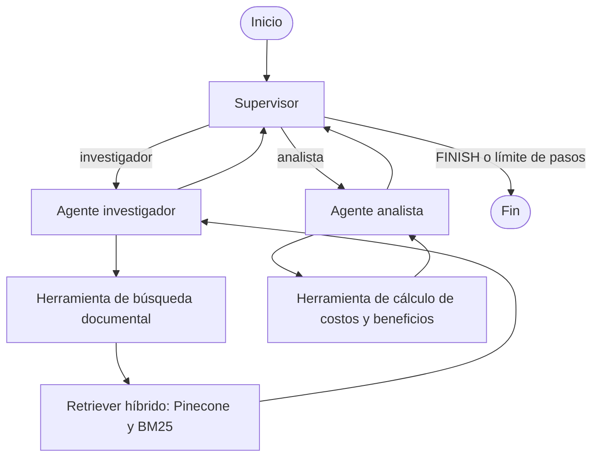

# Sistema multiagente de Rapanui

Aplicación de ejemplo construida con LangGraph. Un supervisor coordina dos agentes especializados para responder consultas documentales y realizar cálculos de beneficios laborales.

## Topología

El grafo usa una topología jerárquica con un supervisor central:

- **Supervisor:** clasifica la consulta y elige `investigador`, `analista` o `FINISH`.
- **Investigador:** consulta la base documental con una búsqueda híbrida (semántica en Pinecone y léxica con BM25) y sintetiza los resultados.
- **Analista:** realiza cálculos de costos y beneficios mediante una herramienta.
- **Retorno al supervisor:** después de cada especialista, el control vuelve al supervisor, que puede delegar otra tarea o finalizar.
- **Límite de seguridad:** el supervisor finaliza cuando `step_count` alcanza 6. El contador aumenta cuando responde un especialista.

## Justificación del diseño y manejo de conflictos

- **¿Por qué una topología jerárquica (Supervisor)?**  
  Centraliza el control de flujo en un único decisor con salida estructurada. Esto desacopla las responsabilidades de cada especialista: el investigador solo recupera contexto documental y el analista solo realiza cómputo cuantitativo, evitando ejecuciones desordenadas o redundantes.
- **Manejo de conflictos y validación:**  
  Ningún especialista puede finalizar el flujo de forma autónoma. Todas las salidas retornan al Supervisor, quien evalúa la suficiencia de la respuesta frente a la consulta inicial antes de derivar a `FINISH`. Además, el contador `step_count` actúa como salvaguarda ante estancamientos o discrepancias reiteradas entre agentes.




## Flujo de una consulta

1. `main.py` crea el grafo y envía la consulta inicial al supervisor.
2. El supervisor produce una decisión estructurada para delegar o terminar.
3. Si corresponde, `graph.py` enruta la ejecución al agente elegido.
4. El agente puede invocar su herramienta y redacta una respuesta.
5. LangGraph vuelve al supervisor para decidir el siguiente paso.
6. El flujo termina cuando el supervisor devuelve `FINISH` o se alcanza el límite de pasos.

El estado compartido hereda la lista de mensajes de LangGraph y también contempla la siguiente decisión, datos de investigación y análisis, y el contador de pasos. `graph.py` usa `MemorySaver` como checkpointer en memoria.

## Componentes principales

| Archivo | Responsabilidad |
|---|---|
| `main.py` | Ejecuta una consulta de ejemplo y muestra la traza de nodos. |
| `graph.py` | Define los nodos, el enrutamiento y los retornos al supervisor. |
| `state.py` | Define el estado compartido del grafo. |
| `agents/supervisor.py` | Decide qué especialista debe intervenir o si debe finalizar. |
| `agents/research_agent.py` | Investiga en la base documental y resume los resultados. |
| `agents/analyst_agent.py` | Calcula costos y presenta un reporte. |
| `tools.py` | Define las herramientas de búsqueda y cálculo. |
| `ingesta.py` | Prepara documentos, genera embeddings y los carga en Pinecone. |
| `retriver.py` | Combina la búsqueda semántica y la búsqueda léxica BM25. |

## Requisitos de ejecución

- Python y las dependencias de LangChain, LangGraph, Ollama y Pinecone utilizadas por el proyecto.
- Ollama instalado y disponible localmente, con los modelos `qwen2.5:7b`, `qwen2.5:3b` y `nomic-embed-text`.
- Un índice de Pinecone y una clave de API.

Configura estas variables en un archivo `.env` en la raíz del proyecto:

```dotenv
PINECONE_API_KEY=tu_clave_de_pinecone
PINECONE_INDEX_NAME=rag-pinecone-768
```

No incluyas credenciales reales en el repositorio. Al importar `tools.py`, el proyecto prepara la base documental y el retriever; por ello, al iniciar necesita acceso a Pinecone y a Ollama.

## Ejecución

Desde la raíz del proyecto, ejecuta:

```bash
python main.py
```

La consulta de ejemplo de `main.py` pregunta por los beneficios de salud y gimnasio y estima el costo de cubrirlos para 25 empleados.
